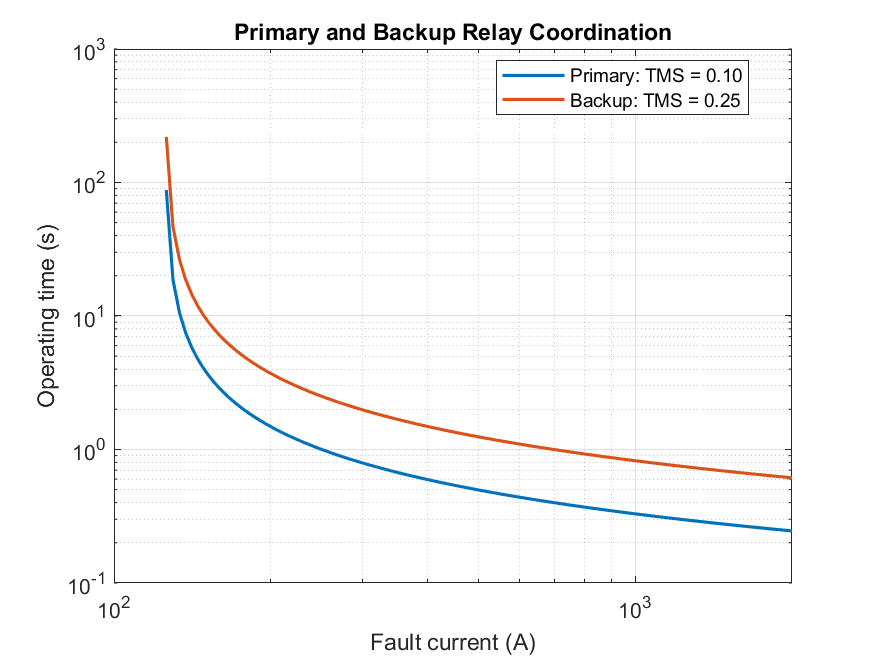
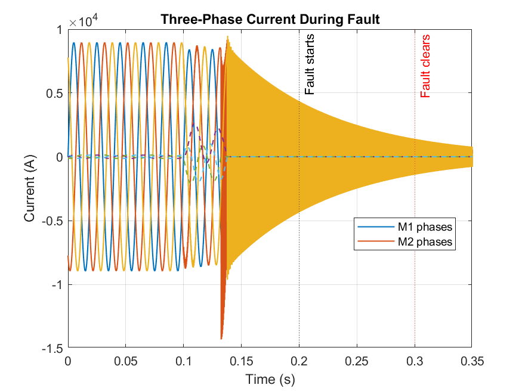
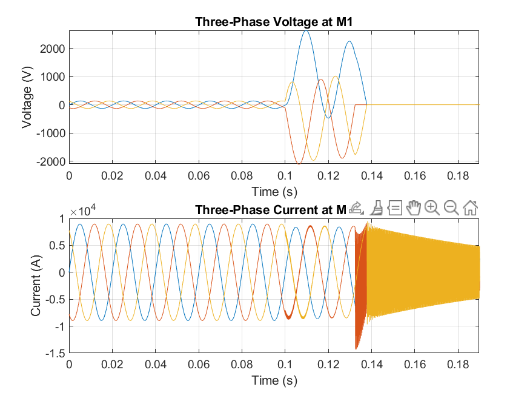
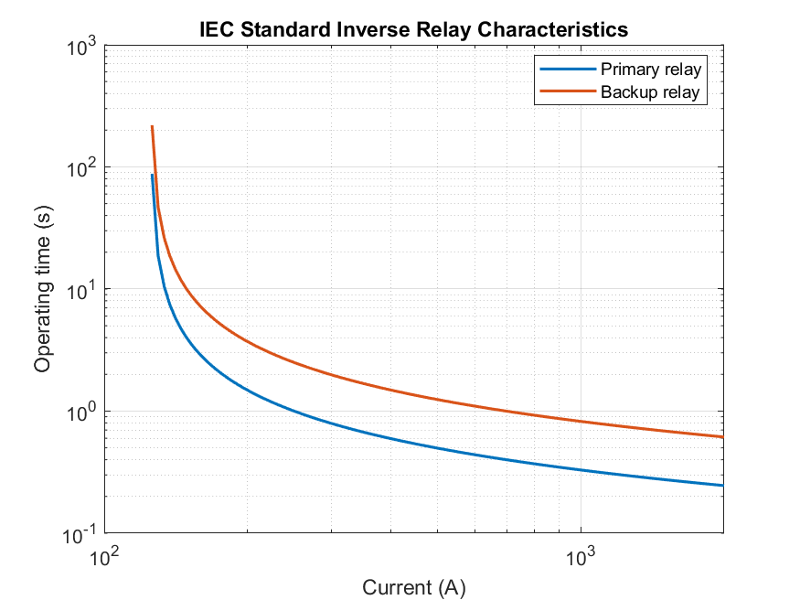

# Transmission Line Fault Detection and Overcurrent Relay Coordination

**Project domain:** Electrical Engineering — Power System Protection  
**Software:** MATLAB/Simulink R2024a  
**Institution:** Nirma Institute of Technology  


## 1. Project Overview

This project studies transmission-line faults and overcurrent relay coordination in MATLAB/Simulink. The model contains a three-phase source, transmission line, three-phase load, fault block, two circuit breakers for primary and backup protection, voltage/current measurement blocks, RMS measurement, relay logic, and `powergui`.

The project tests normal operation and four fault conditions: single-line-to-ground (L-G), line-to-line (L-L), double-line-to-ground (L-L-G), and three-phase (L-L-L). The measured waveforms and relay characteristic plots are used to discuss fault response and the intended sequence of primary and backup protection.


## 2. Project Objectives

- Model a three-phase transmission network in Simulink.
- Observe three-phase voltage and current during normal and faulted operation.
- Use RMS current values as the operating quantity for overcurrent logic.
- Implement IEC standard-inverse relay characteristics.
- Compare primary and backup relay timing.
- Plot current/voltage waveforms, relay characteristics, coordination curves, and trip/breaker signals.
- Document the test cases, results, assumptions, and limitations.

## 3. Folder Structure

The README follows the folders shown in the project directory:

```text
Transmission-Line-Fault-Protection/
├── README.md
├── 01_Simulation_Model/
│   └── Transmission_Line_Protection.slx
├── 02_Results_and_Graphs/
│   ├── coordination_curves.png
│   ├── fault_current.png
│   ├── normal_operation.png
│   └── relay_characteristics.png
├── 03_Technical_Report/
│   ├── Project_Overcurrent_Relay_Report.pdf
│   └── Project_Results_and_Graphs.pdf
├── 04_Matlab_Code/
│   ├── initialize_parameters.m
│   ├── plot_results.m
│   └── run_fault_tests.m
└── 05_Screenshots/
    └── [Simulink model and block-parameter screenshots]
```


## 4. System Block Diagram

```text
Three-phase source
       |
Breaker 2 — Backup protection
       |
Three-Phase V-I Measurement (M2)
       |
Breaker 1 — Primary protection
       |
Three-Phase V-I Measurement (M1)
       |
Transmission-line section ---- Three-Phase Fault block
       |
Three-phase load
```

M1 and M2 measure voltage and current at two points in the network. The phase currents are passed through RMS blocks; a maximum-selection block selects the largest phase RMS current for the simplified phase-overcurrent relay. Relay logic generates trip signals for the breakers. The `powergui` block configures the Specialized Power Systems simulation environment.

## 5. Software and Model Requirements

- MATLAB/Simulink R2024a.
- Compatible Specialized Power Systems blocks, including a three-phase source, line, load, circuit breakers, fault block, and voltage/current measurement blocks.
- RMS and relay-logic blocks.
- `powergui`.

Use the block libraries already used by `Transmission_Line_Protection.slx`; do not mix incompatible modeling technologies without the required interfaces.

## 6. Model Parameters

The following values are available in the supplied MATLAB parameter script and project report. Confirm the final model block settings before submission.

| Parameter | Value |
|---|---:|
| Line-to-line source voltage | 11 kV RMS |
| Frequency | 50 Hz |
| Source resistance | 0.1 Ω |
| Source inductance | 1 mH |
| Transmission-line length | 20 km |
| Positive-sequence resistance | 0.01273 Ω/km |
| Positive-sequence inductance | 0.9337 mH/km |
| Positive-sequence capacitance | 12.74 nF/km |
| Zero-sequence resistance | 0.3864 Ω/km |
| Zero-sequence inductance | 4.1264 mH/km |
| Zero-sequence capacitance | 7.751 nF/km |
| Load active power | 1.8 MW |
| Load reactive power | 0.872 MVAr |
| Primary relay pickup | 125 A |
| Backup relay pickup | 125 A |
| Primary TMS | 0.10 |
| Backup TMS | 0.25 |
| Fault start time | 0.2 s in `initialize_parameters.m` |
| Fault clear time | 0.3 s in `initialize_parameters.m` |
| Fault resistance | 0.01 Ω |
| Ground resistance | 0.01 Ω |
| Simulation sample time | 1e-4 s |
| Simulation stop time | 0.35 s |

The report/result screenshots may show different event timing depending on which model version was run. Use the timing configured in the final `.slx` model and verify it against the plotted time axis.

## 7. Protection Theory

### 7.1 Overcurrent pickup

The simplified relay operates when the maximum phase RMS current exceeds the pickup setting:

\[
I_{\max}=\max(I_{A,\mathrm{RMS}},I_{B,\mathrm{RMS}},I_{C,\mathrm{RMS}})
\]

The pickup setting is \(I_s=125\text{ A}\), and the current multiple is:

\[
M=\frac{I}{I_s}
\]

### 7.2 IEC standard-inverse characteristic

The MATLAB plotting code uses:

\[
t=\frac{0.14\,\mathrm{TMS}}{M^{0.02}-1}
\]

where \(t\) is ideal relay operating time in seconds, TMS is the time-multiplier setting, and \(M=I/I_s\). The expression applies above pickup. At or below pickup, the ideal relay should not operate.

### 7.3 Primary and backup coordination

The primary characteristic uses TMS = 0.10, while the backup characteristic uses TMS = 0.25. For the same current multiple, the higher backup TMS gives a longer ideal operating time. The coordination time difference is:

\[
\Delta t=t_{\mathrm{backup}}-t_{\mathrm{primary}}
\]

The characteristic curves show intended time grading, but final coordination should also be checked against relay trip signals and breaker response.

## 8. MATLAB Code and How to Run

The three MATLAB files are stored in `04_Matlab_Code/`, not in a `scripts/` folder.

### `initialize_parameters.m`

Defines the source, transmission line, load, relay pickup/TMS, fault timing/resistance, sample time, and stop time.

### `run_fault_tests.m`

Finds the project root from its own location, runs `initialize_parameters.m`, loads `01_Simulation_Model/Transmission_Line_Protection.slx`, sets the simulation stop time, runs the model, and saves `simulation_data.mat` in `02_Results_and_Graphs/`.

### `plot_results.m`

Loads `simulation_data.mat`, reads the logged signals `Vabc_M1`, `Iabc_M1`, `Vabc_M2`, and `Iabc_M2`, and generates four figures: normal operation, fault current, IEC relay characteristics, and relay coordination curves.

### Run sequence

1. Open MATLAB.
2. Set the current folder to the project root containing the five numbered folders.
3. Confirm that the model is named `Transmission_Line_Protection.slx` inside `01_Simulation_Model/`.
4. Run `04_Matlab_Code/run_fault_tests.m`.
5. After the simulation finishes, run `04_Matlab_Code/plot_results.m`.
6. Check that the four plot images are saved in `02_Results_and_Graphs/`.

The scripts expect the model to log the signal names listed above. If the model uses different logging names, update `plot_results.m` to match. The backup-protection test arrangement and breaker trip polarity should also be checked in the actual model.

## 9. Results and Graphs

The four images below are stored in `02_Results_and_Graphs/`. Ensure the images are regenerated from the final `.slx` model before treating them as the final results.

### 9.1 Primary and backup relay coordination



The graph compares the ideal IEC standard-inverse curves for primary TMS = 0.10 and backup TMS = 0.25. The backup curve is above the primary curve, indicating a longer ideal operating time for the same current multiple.

### 9.2 Three-phase current during fault



The figure compares measured currents at M1 and M2 and marks the configured fault-start and fault-clear times. Verify that the plotted event timing matches the final model settings before interpreting the waveform.

### 9.3 Normal-operation waveforms



This figure displays three-phase voltage and current at M1 during the normal-operation interval.

### 9.4 IEC standard-inverse relay characteristics



The primary and backup relay operating times decrease as current increases above pickup. The plotted characteristics are calculated from the IEC equation and configured TMS values.

## 10. Fault Test Cases

Run each case separately, restoring the initial breaker and relay states before every run.

| Test | Fault configuration | Expected observation |
|---|---|---|
| Normal load | Fault block disabled | No unwanted relay trip |
| L-G | Phase A to ground | Fault-current/voltage disturbance and protection response |
| L-L | Phases A and B; ground disabled | Fault-current/voltage disturbance and protection response |
| L-L-G | Phases A and B to ground | Fault-current/voltage disturbance and protection response |
| L-L-L | Phases A, B, and C; ground disabled | Three-phase fault response and protection operation |

For primary testing, keep the primary breaker trip path enabled. For a backup test, temporarily prevent the primary breaker from opening while leaving the backup relay and breaker trip path operational. Restore the normal primary trip connection after testing.

## 11. Reported Results

The following values are transcribed from the supplied `Project_Results & graphs.pdf` and technical report. They are reported simulation values, not field measurements.

| Fault case | Fault current (A RMS, approx.) | Primary relay time (s) | Backup relay time (s) | Reported result |
|---|---:|---:|---:|---|
| Normal load | 105 | No trip | No trip | Pass |
| L-G | 700 | 0.050 | 1.18 | Pass |
| L-L | 1,350 | 0.035 | 0.85 | Pass |
| L-L-G | 1,400 | 0.030 | 0.80 | Pass |
| L-L-L | 1,580 | 0.030 | 0.80 | Pass |

The reported primary relay times decrease for the higher-current fault cases, consistent with inverse-time behavior. The listed backup times are longer than the primary times. The raw time-series data and exact timing cursors are not included in the results PDF, so verify the numerical values against the final simulation logs before using them as independently measured results.

## 12. Validation Checklist

- [ ] Confirm the final `.slx` file path and the model's logged signal names.
- [ ] Run normal operation with the fault block disabled.
- [ ] Run L-G, L-L, L-L-G, and L-L-L faults separately.
- [ ] Check fault inception/clear times against the final block configuration and plotted time axis.
- [ ] Confirm the relay uses RMS current rather than instantaneous peak current.
- [ ] Compare ideal relay times calculated from the measured current multiple with the simulated relay trip times.
- [ ] Record relay trip-command time separately from breaker opening/current interruption.
- [ ] Confirm the backup test leaves the backup trip path enabled.
- [ ] Update the results table if the final model outputs differ from the supplied report.

## 13. Limitations

- The model is a simulation and has not been validated against field measurements.
- The supplied results do not include raw logged data for independently recalculating every RMS current and relay time.
- Practical relay filtering, CT saturation, measurement errors, communication delays, and detailed breaker interruption behavior are not fully documented.
- The exact solver configuration should be confirmed in the final Simulink model.
- The IEC curves show ideal relay operating characteristics; they do not by themselves prove the complete breaker-clearing sequence.

## 14. Future Scope

- Add distance protection for transmission-line protection.
- Add residual/earth-fault protection using zero-sequence current.
- Model current-transformer saturation and its effect on relay performance.
- Include detailed breaker dynamics and evaluate the coordination time interval.
- Explore communication-assisted protection or hardware-in-the-loop testing.
- Export simulation logs into MATLAB tables for reproducible numerical analysis.

## 15. Conclusion

This project documents a MATLAB/Simulink study of transmission-line faults and overcurrent relay coordination. The model includes a three-phase source, transmission line, load, fault insertion, voltage/current measurements, RMS-based relay logic, primary and backup relays, and circuit breakers. The supplied plots illustrate normal operation, fault-current behavior, IEC standard-inverse relay characteristics, and primary/backup coordination. The results document reports no trip during normal load and protection operation for four fault types. The final repository should retain the actual numbered-folder structure and include results verified against the final Simulink model.

## 16. References

1. MathWorks, *Simulink Documentation*: https://www.mathworks.com/help/simulink/
2. MathWorks, *Simscape Electrical Documentation*: https://www.mathworks.com/help/simscape-electrical/
3. MathWorks, *Overcurrent Relay Protection in AC Microgrid*: https://www.mathworks.com/help/simscape-electrical/ug/relay-overcurrent-protection.html
4. International Electrotechnical Commission, *IEC 60255-151:2009 — Measuring Relays and Protection Equipment: Functional Requirements for Over/Under Current Protection*, 2009.
